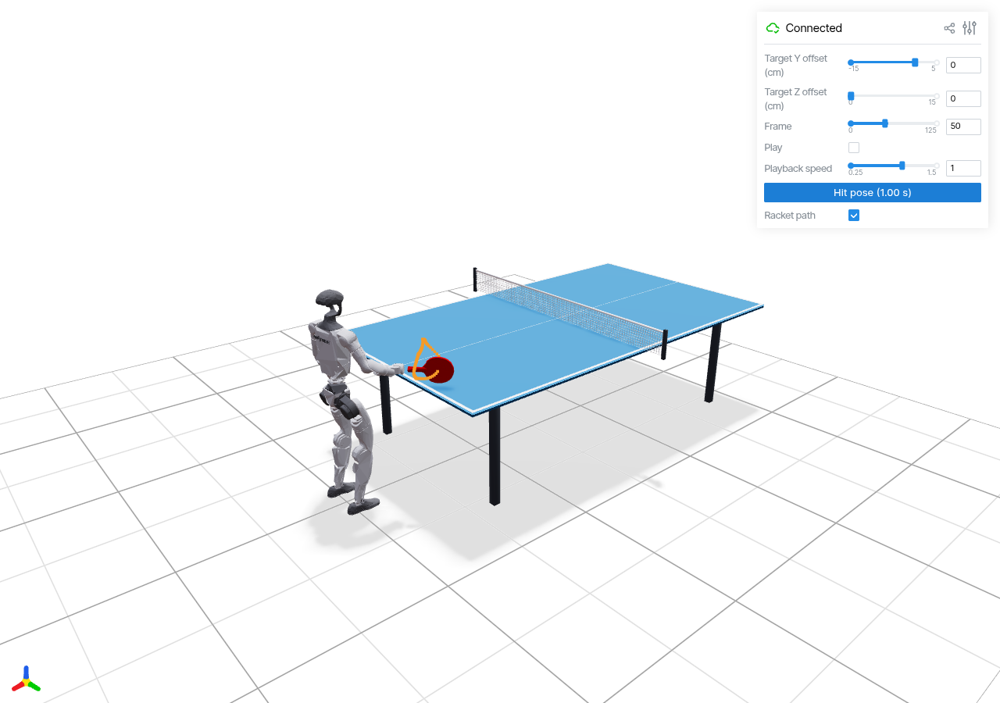

# G1 Table-Tennis Motion Kit



Self-contained right-arm **forehand** reference generator and interactive Viser
viewer using VICAR's G1 robot with the integrated right-wrist racket. Includes
the 20 solved target variants shown in the original viewer. No GR00T checkout,
private data, cloud services, model checkpoint, Isaac Sim, or GPU is needed for
generation and browser visualization. Installing Python dependencies requires
network access unless they are already cached.

**These are kinematic references, not a trained policy or a physically simulated
ball return. Do not command a real robot directly with these arrays.** The
included simplified visual URDF has no collision or inertia elements. Balance,
self-collision, actuator limits, controller tracking and real racket calibration
need separate validation. The optional MuJoCo video renderer only animates poses;
it does not establish physical feasibility.

## 1. Install

Tested on Linux with Python 3.11. Use Python 3.10-3.12; Python 3.11 is pinned in
`.python-version`. Install [uv](https://docs.astral.sh/uv/getting-started/installation/)
if needed. In this repository:

```bash
uv sync --locked --extra test
uv run --extra test pytest -q
uv run python scripts/validate_bundle.py
```

`uv.lock` pins the full dependency graph. `pyproject.toml` pins the direct
numerical and visualization dependencies. A fresh virtual environment is
recommended; do not reuse an Isaac Sim environment.

## 2. View the Included Motions Immediately

No IK solve is required to view the examples:

```bash
uv run python scripts/preview_table_tennis_forehand.py \
  --bundle-dir examples/forehand_grid --viser --port 8080
```

Open http://localhost:8080. Controls include Y/Z target offsets, play/pause,
frame, speed, racket path and **Hit pose (1.00 s)**. All 20 slider combinations
load independent saved motions. Mouse orbit, pan and zoom remain free during
playback and when changing the target.

The two sliders are **Y and Z, not X and Z**. This follows the requested lateral
and vertical target ranges. X is fixed. They select a 5 cm grid, not continuous
IK and not interpolation between joint sequences. The target marker is a
reference contact marker, not a simulated moving ball.

For remote use, connect through your private Tailscale IP or an SSH tunnel:

```bash
ssh -L 8080:localhost:8080 USER@HOST
```

Then open localhost:8080 on the client. If occupied, choose another port in both
commands. The server binds to all interfaces and has no login; do not expose it
to the public internet. Ctrl-C stops the foreground viewer. No systemd service
or AgentsDock setup is required by this package.

## 3. Regenerate

First reproduce the nominal forehand:

```bash
uv run python -u scripts/build_table_tennis_forehand_bundle.py \
  --table-scene --forehand --right-shoulder-roll-max -0.3 \
  --output-dir outputs/nominal

uv run python scripts/preview_table_tennis_forehand.py \
  --bundle-dir outputs/nominal --viser --port 8080
```

The default URDF is `assets/vicar/g1.urdf`. The included robot requires both
`--table-scene` and `--forehand`; older synthetic-racket branches remain in the
script for historical tests, but no other robot is required or supplied.

A different contact location can be solved with an XYZ offset in metres:

```bash
uv run python -u scripts/build_table_tennis_forehand_bundle.py \
  --table-scene --forehand --right-shoulder-roll-max -0.3 \
  --target-offset 0 -0.15 0.05 --output-dir outputs/right_low
```

Regenerate the full 20-motion grid, leaving supplied examples unchanged:

```bash
uv run python -u scripts/build_table_tennis_forehand_grid.py \
  --output-dir outputs/forehand_grid

uv run python scripts/validate_bundle.py --bundle-dir outputs/forehand_grid
uv run python scripts/preview_table_tennis_forehand.py \
  --bundle-dir outputs/forehand_grid --viser --port 8080
```

Optimization is CPU-only and may take minutes or longer for the whole grid.
Successful variants are cached using generator SHA-256, URDF SHA-256, target
offset and required files. Re-run the same command after an interruption. A
failed/unreachable target is reported in `motion_grid.json`; it is never silently
replaced with a nearby target. Do not disable assertions or loosen tolerances
just to force a target to pass.

`--pack-only` assembles existing validated variants without re-solving; it
deliberately permits their historical generator hashes to differ. Use it only
when preserving an already validated set. The supplied examples contain 18
original solutions plus two repaired solutions with their original hashes;
they were not all generated by the standalone refactoring's new script hash.

## 4. Motion Specification

Units: metres, radians and seconds. World axes: +X forward into the table,
+Y robot-left, +Z up. Pelvis starts at X=Y=0, centered on the near end of the
table and facing +X. Its fixed Z is chosen from the stance's foot visual meshes
to place the soles on the floor; read `root_pos[0]` for the exact value.

| Quantity | Value |
| --- | --- |
| Sampling | 50 Hz, 126 frames, t=0 through t=2.5 s inclusive |
| Impact | Zero-based frame 50, t=1.0 s |
| Nominal contact target XYZ | (0.43, -0.38, 0.86) m |
| Y offsets | -0.15, -0.10, -0.05, 0, +0.05 m |
| Z offsets | 0, +0.05, +0.10, +0.15 m |
| Absolute contact Y | -0.53 through -0.33 m |
| Absolute contact Z | 0.86 through 1.01 m |
| Contact above tabletop | 0.10 through 0.25 m |
| Table length / width / height | 2.74 / 1.525 / 0.76 m |
| Near table edge | X=0.36 m |
| Net height above table | 0.1525 m |
| Right shoulder roll upper bound | -0.3 rad, NOT a fixed joint angle |

Motion phases (smooth spline knots, not rigidly separated holds):

| Time | Motion |
| --- | --- |
| 0-0.45 s | Ready pose into compact right-side backswing |
| 0.45-0.70 s | Continuous loading/transition, not a frozen pause |
| 0.70-1.00 s | Accelerate forward/across toward impact |
| 1.00-1.30 s | Follow through with nonzero impact velocity |
| 1.30-1.50 s | Settle |
| 1.50-2.50 s | Quintic joint-space return to exactly the starting pose |

Pelvis and all 12 leg joints remain fixed. Hip pitch is -0.18 rad, knees 0.36,
ankle pitch -0.18. Waist roll/pitch remain zero; waist yaw follows a modest turn
with knots [0, -12, -12, 6, 18, 16, 0] degrees. The left arm's joint angles stay
fixed, but its hand moves with the waist (about 10 cm for the nominal motion).

Racket face is vertical at impact, with nominal face normal approximately
(0.707, 0.707, 0), not necessarily straight +X. Blade yaw knots are
[45, 35, 35, 45, 60, 60, 45] degrees. A farther-right target tilts the shaft down
by up to 20 degrees near contact while preserving a vertical impact face.

Nonzero target offsets use a knot envelope [0, 0.5, 0.8, 1, 0.5, 0, 0], not
a translation of the entire stroke. Contact velocity changes from nominal
(0.9, 0.6, 0.15) toward (0.7, 0.75, 0.15) m/s for the farthest-right target.
This keeps follow-through reachable with a stationary base. The grid varies
the contact and parts of the approach, not the standing location.

## 5. Solver and Acceptance Checks

Sequential bounded IK seeds seven right-arm joints. Sparse whole-sequence
least squares then tracks full racket orientation and position, penalizes
joint differences, and shares endpoint variables for an exact loop. Torso yaw
is prescribed, not optimized. No neural model or downloaded motion dataset is
used. `motion_format.py` provides only joint ordering and axis-angle encoding;
it replaces the original door-generator import.

Refinement residual multipliers: position 100 nominal, 250 offset variants,
300 at the farthest-right/lowest corner; full rotation 20; first difference
0.3; second difference 6. These are residual multipliers, so their squared
values enter the least-squares objective. Nonzero-offset variants may use
wider URDF-valid shoulder/wrist bounds, still with the -0.3 roll upper cap.

The generator rejects excessive tracking errors, nonfinite arrays, joint-limit
violations, moving legs/left-arm joints, and mismatched loop endpoints. Required
full-path error is under 2 mm and 0.5 degrees, impact height error under 1 mm,
and face deviation from vertical under 0.5 degrees.

`validate_bundle.py` recomputes FK for every frame of the saved grid, compares
it with the stored targets/achieved poses, checks frozen body parts and data
formats, and checks all 20 target coordinates. This is not collision or
dynamics validation. Prior visual-AABB/table checks found no tabletop overlaps,
but that does not prove self-collision freedom. Peak nominal joint speed is
about 8.61 rad/s and acceleration 142.85 rad/s^2; do not assume hardware can
track the motion safely.

## 6. File Formats and Layout

```text
assets/vicar/                 Unchanged visual URDF, 35 PLY meshes, LICENSE, provenance
examples/forehand_grid/       20 ready-to-view motions and packed bundles
scripts/                     Generator, grid packer, viewer, validator, format helpers
tests/                       Unit, asset-integrity and numerical/FK checks
ASSET_PROVENANCE.json         Upstream revision and packaged file hashes
pyproject.toml, uv.lock       Dependency specification and lock
AGENTS.md                    Short instructions for the next agent
```

Each motion has `reference.npz`, `metadata.json`, `processed_robot_motions.pkl`
and `motion_meta_bundle.pkl`. The grid root has packed dictionaries with unique
offset-based keys and `motion_grid.json` mapping each target to its directory.
Only load trusted `.pkl` files: joblib/pickle can execute code. The `.npz` numeric
arrays can be inspected without pickle:

```python
import numpy as np
path = "examples/forehand_grid/table_tennis_forehand_y+000_z000/reference.npz"
with np.load(path, allow_pickle=False) as motion:
    print(motion.files)
    print(motion["joint_names"])
    print(motion["cfg_urdf"][50])
    print(motion["actual_contact_pos"][50])
```

`reference.npz`: `time` (T,), `dof` (T,29) canonical order, `cfg_urdf` (T,29)
URDF order, `joint_names`, `root_pos` (T,3), `root_wxyz` (T,4), wrist transforms,
and target/actual contact arrays. Use names when mapping joints; never assume
canonical and URDF column orders are identical. `actual_hand_pos` is a grip
point, whereas `actual_contact_pos` is the racket face point. Use the latter
for impact validation.

Packed motion values contain `dof`, `root_trans_offset`, `root_rot` (WXYZ),
`pose_aa` (T,30,3: root plus 29 local joint-axis rotation vectors), `fps`, and
constant +1 closed hand action arrays. Those action arrays are compatibility
placeholders: this VICAR model has no actuated gripper. `smpl_joints` is an
unused zero placeholder, not a valid human skeleton.

Metadata includes the targets, bounds, solver/URDF hashes, limitations and
validation measurements. `urdf` paths are relative to the containing metadata
file's directory (including packed metadata at the grid root). The viewer
resolves them there rather than against the shell working directory. Keep the
repository layout together when moving it. To relocate generated output alone,
update metadata paths and preserve the corresponding URDF hash.

## 7. Optional Video Export

```bash
uv sync --locked --extra test --extra video
uv run --extra video python scripts/preview_table_tennis_forehand.py \
  --bundle-dir examples/forehand_grid/table_tennis_forehand_y+000_z000
```

This writes `forehand_preview.mp4` and selected PNG frames inside that motion's
directory (ignored by Git). Choose a single motion directory, not the grid root.
It renders labeled front-right/right-side views, a 1x replay, and a separately
labeled 0.5x replay. Rendering needs an OpenGL backend. Linux defaults to EGL;
on a desktop where EGL is unavailable try `MUJOCO_GL=glfw` with a display.
Viser itself does not require this optional renderer or a server-side GPU.

## 8. Robot Provenance and Scope

Source: https://github.com/ember-center-berkeley/VICAR/tree/07458b4b55f2687d2b17ee89613fdd12f0904fee/visualization/robot-racket

Pinned revision: `07458b4b55f2687d2b17ee89613fdd12f0904fee`.
Included `g1.urdf` SHA-256:
`b482b6a3ece50e545b466e813aa4d6a54d6e1602d8d1faca0b13016dc433fb89`.

The visual model has 29 actuated joints, fixed `right_racket` and fixed
`left_ball_holder`. Racket transform relative to `right_wrist_yaw_link` is
translation (0.2365,0,0) m and identity rotation. Shaft is local +X, blade plane
XZ, face normal +Y. Contact is the racket origin plus 6.2 mm along its local +Y,
estimated from the mesh, not a physical calibration. No YAM grippers or
backpack are included. The table/net are generated procedurally by the viewer.

Upstream `provenance.json` describes simplification from a different source
URDF; its source URDF hash is NOT the hash of this distributed visual model.
All 38 asset files are retained with their upstream license/provenance.
See NOTICE.md before public distribution. This package covers the latest VICAR
forehand grid, not earlier Thor/YAM synthetic-racket backhand experiments.

## 9. Push This Repository to GitHub

See [the verification receipt](docs/VERIFICATION.md) for the tested scope.

The prepared local directory is already a Git repository on branch `main` with
an initial commit. Nothing has been pushed and no remote is configured. Create
an **empty private** GitHub repository named `table-tennis-motion-kit` (do not
initialize it with a README), then run from this directory:

```bash
git remote add origin git@github.com:YOUR_USERNAME/table-tennis-motion-kit.git
git push -u origin main
```

Alternatively, with GitHub CLI installed and authenticated:

```bash
gh repo create YOUR_USERNAME/table-tennis-motion-kit --private --source=. --remote=origin --push
```

Use one method, not both. Do not put a GitHub access token in a URL or file.
No Git LFS or submodules are needed. Dependencies/outputs are ignored; the small
URDF, meshes and example bundles are tracked directly. Review licensing before
changing visibility to public.

A `.bundle` handoff can be cloned without network access, preserving commits:

```bash
git clone table-tennis-motion-kit.bundle table-tennis-motion-kit
cd table-tennis-motion-kit
git remote remove origin
```

Then add your GitHub origin using the commands above. A source archive does not
contain Git history; after extracting one, run `git init -b main`, `git add .`
and `git commit -m "Add standalone G1 table-tennis motion kit"` first.
